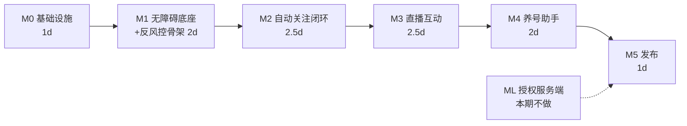

# DGG（抖关关）开发计划

> 状态：**v2 已按确认意见修订** · 更新日期：2026-10-25 · 基线分支：`develop`
> 当前进度：UI 三页签骨架完成（纯界面 + Toast 占位），本计划负责把它变成可运行的工具

## 修订记录

| 版本 | 变更 |
|---|---|
| v1 | 初次编制，含服务端授权里程碑 |
| **v2** | ① 授权服务端本期**不做**，改为客户端抽象 + 本地占位（服务端由用户另开）② 抖音版本不作限制 ⇒ 定位改为多特征投票 ③ 降封号升级为**硬性验收项**（新增 §3） |

---

## 1. 目标与范围

**目标**：在抖音客户端上实现「自动关注 / 养号助手 / 直播互动」三类自动化，全程可诊断、可中断、可续跑，并把封号风险降到工程可控的最低。

| 决策项 | 结论 |
|---|---|
| 授权体系 | **本期只做客户端抽象 `LicenseProvider` + 本地占位实现**；服务端由你另开，接口边界已定（§5.4），就绪后替换实现即可，不动 UI |
| 自动化底座 | **无障碍控件树 + 图像识别兜底**（树优先，图像兜底，双路失败即停） |
| 抖音版本 | **不限定版本** ⇒ 定位必须多特征投票，禁止依赖单一控件/单一版本的特征 |
| 首发功能线 | **自动关注**，跑通后复制到直播互动、养号助手 |
| 封号风险 | 已知悉并接受；要求把「降特征」作为**硬性验收项**而非可选优化 |

**明确不在本期**：
- 授权服务端（另行开发，客户端预留接入点）
- 上架应用商店（自动化工具过不了审核，保活也依赖侧载）
- 多账号并发、代理 IP、设备指纹伪造等对抗手段

---

## 2. 总体架构

```
com.example.dgg
├─ ui/
│   ├─ MainActivity               三页签（本次改造：参数双向绑定）
│   └─ LogActivity                新增：日志页
├─ service/
│   ├─ DggAccessibilityService    常驻无障碍服务
│   ├─ ControlService             前台服务：任务宿主 + 通知 + 状态上报
│   └─ FloatWindowService         悬浮窗：状态 + 一键停止
├─ engine/
│   ├─ TaskEngine                 状态机、定时步进、熔断、暂停/恢复/停止
│   ├─ PageDetector               页面识别（多特征投票，非单一特征）
│   ├─ Actions                    原子操作原语
│   ├─ Locator                    定位抽象（树 / 图像双通道）
│   ├─ Vision                     MediaProjection 截图 + 模板匹配
│   └─ risk/
│       ├─ Humanizer              延迟/轨迹/输入的拟人化
│       └─ AnomalyGuard           异常提示识别 → 立即停机
├─ data/
│   ├─ Settings                   DataStore 持久化（三页全部字段）
│   ├─ LogStore                   环形日志缓冲（2000 条）
│   ├─ FollowedStore              已关注用户去重库
│   └─ license/
│       ├─ LicenseProvider        接口（状态/到期/激活/解绑）
│       └─ LocalLicenseProvider   本期占位实现，服务端就绪后换 Remote 实现
└─ config/
    └─ LocatorConfig              assets 下的定位规则 JSON（可热更新）
```

### 2.1 定位双通道 + 多特征投票

```kotlin
sealed interface Target {
    data class ByText(val text: String) : Target
    data class ByTextContains(val text: String) : Target
    data class ById(val viewId: String) : Target
    data class ByDesc(val desc: String) : Target
    data class ByImage(val template: String, val threshold: Float) : Target   // 兜底
}
```

解析顺序固定：**控件树 → 图像 → 放弃**。连续 N 次树通道未命中才触发一次截图匹配；两路都失败 → 状态置 `UNKNOWN` → **任务暂停**，绝不盲点。

**版本不设限带来的强制约束**：页面判定不允许"命中一个特征就算"。每条规则声明一组特征，采用**加权投票**，得分超过阈值才判定：

```json
{
  "version": 1,
  "pages": {
    "search_result": {
      "features": [
        { "w": 3, "type": "text",          "value": "综合" },
        { "w": 2, "type": "text",          "value": "用户" },
        { "w": 2, "type": "textContains",  "value": "粉丝" },
        { "w": 1, "type": "image",         "value": "tab_user_active", "threshold": 0.82 }
      ],
      "threshold": 5
    }
  }
}
```

好处：抖音某个版本少了一个特征，只要其余特征仍在，判定依然成立——这正是"不限定版本"唯一可行的落地方式。**权重与阈值外置**，改版改 JSON 不发版。

### 2.2 状态机而非线性脚本

状态：`HOME / SEARCH / SEARCH_RESULT / USER_PROFILE / USER_LIST / LIVE_ROOM / ANOMALY / UNKNOWN`

每态定义 `detect`（多特征投票）、`do`、`escape`（超时如何退回）。任态停留超阈值 → `escape` 回 `HOME` 重来，不原地死等。
**安全出口**：悬浮窗或通知栏停止，200ms 内中断，不留半截操作。

---

## 3. 反风控设计（硬性验收项，非可选）

封号风险无法消除，只能降特征。以下五条全部**进入 M1/M2 的验收标准**，缺一条不算完成。

### 3.1 时间维度
- 步间延迟取区间随机（参数来自界面「扫描间隔」，**默认 30 秒**，可配 1 秒 ~ 60 分钟），
  **不用固定值**
  - 2026-10-28 把默认从 1.5 秒提到 30 秒：1.5 秒的间隔在真人视角里是不可能的关注频率，
    是最容易被行为模型识别的特征之一。慢是降封号的一部分，不是性能问题。
  - 界面存「数值 + 单位（秒/分钟）」而不是毫秒：手机上读 1500 / 3600000 没有意义
- 批次间长休：每关注 N 个后休 X 秒（界面可配），并在 X 上叠加 ±30% 抖动
- 日上限：默认 200 次关注/天，可配，到量即停
- 启动时刻随机化：不在整点、不在每次同一分钟开始

### 3.2 交互维度
- 点击点位在控件矩形内**随机偏移**（避开正中，保持边距 ≥15%），不每次落同一点
- 滑动用多段插值 + 速度曲线，不用单段线性 `swipe`
- 文本输入逐字写入，字间 80–200ms 随机，不用一次性 `setText` 整串

### 3.3 行为维度
- 概率性跳过：即使流程走到关注按钮，也按配置概率放弃（让轨迹不是"必关注"）
- 进入主页后随机停留 1–4s 再动作，模拟浏览
- 不总滚到底、不总按固定顺序遍历

### 3.4 数据维度
- 已关注用户去重（本地库），重启续跑不重复关注同一人
- 评论内容去重，避免同一句反复发送

### 3.5 异常即停（**优先级高于以上所有**）
命中以下任一提示，**立即停止任务 + 通知 + 记日志，禁止任何重试**：
- 「操作过于频繁」「请稍后再试」
- 「请完成安全验证」「拖动滑块」「请输入验证码」
- 「登录异常」「账号存在风险」

理由：被风控拦下后继续重试，是从"临时限流"升级为"封号"的最快路径。宁可停，不可试。

---

## 4. 里程碑



**本期合计约 11 天**（ML 不在时间线内）。

### M0 · 基础设施（1 天）✅ 已完成 2026-10-25

- [x] `buildFeatures.viewBinding = true`，重构现有 findViewById（后续代码量翻数倍，先做成本最低）
- [x] `Settings` + 持久化，三页所有字段双向绑定（改 → 存，冷启 → 回填）
- [x] 日上限 / 随机抖动等新参数补进界面（放在「参数设置」内，不新增页签）
- [x] `LogStore` + `LogActivity`（级别过滤、复制/导出文件分享）
- [x] 权限引导真实跳转：无障碍、悬浮窗、通知、电池优化白名单
- [x] 「打开抖音」真实启动 `com.ss.android.ugc.aweme`
- [x] `LicenseProvider` 接口 + `LocalLicenseProvider` 占位（返回固定到期时间，标注「本地占位」）

**验收（已实测）**：改「目标关注数量」为 777 → `am force-stop` 冷启动 → 输入框回填 777、开关状态恢复；
日志页显示真实事件（含权限状态、权限申请结果）；点「通知权限」弹出系统运行时授权框，允许后卡片即时变「已授权」；
授权信息卡读 `LicenseProvider`，状态显示「已授权（本地占位）」。

#### M0 实施偏离（与原计划的差异及原因）

| 原计划 | 实际 | 原因 |
|---|---|---|
| DataStore 持久化 | **SharedPreferences** | 全部参数是 26 个标量，无嵌套/迁移需求；`datastore-preferences` 本机未缓存需联网，且会引入一整套协程 Flow 管道。出现嵌套结构或跨进程观察时再换 |
| RecyclerView 做日志列表 | **ScrollView + 动态 TextView** | `recyclerview` 本机只缓存 1.1.0（过旧）；日志只渲染末 400 条，够用且零依赖 |
| 权限卡片用 `<include>` 复用 | **自绘 `PermissionCardView`** | `include` 会让内部 id 在同一视图树重复，`findViewById` 只命中第一个，第二、三页状态永远刷不出来。实测已验证三页各自刷新 |
| 参考图只有 2 行权限 | **补第 3 行「通知权限」** | API 33+ 通知是运行时权限，不申请则前台服务通知不可见，而"通知常驻"是保活承诺的前提 |
| 无 | 新增 `POST_NOTIFICATIONS` 声明 + 运行时申请 | 同上；首版实测该项恒为「未授权」，是漏声明导致 |
| 无 | 新增 `REQUEST_IGNORE_BATTERY_OPTIMIZATIONS` | 「保活设置」入口直接跳忽略电池优化授权页 |
| 权限 3 行卡片（每行状态文字 + 「去授权」按钮） | **vc44 起改为三个并列小点**（绿=已授权 / 红=未授权，点哪跳哪） | 三行卡纵向约 150dp，把「开始服务」挤到屏幕很下面；而这三个权限的日常信息量只有一个布尔值。文案固定为「无障碍 / 悬浮窗 / 通知」，状态只用颜色表达，缺权限时文字一起变红；点本身带 `contentDescription`，色弱/读屏也能分辨 |


### M1 · 无障碍底座 + 反风控骨架（2 天）✅ 已完成 2026-10-26

- [x] `DggAccessibilityService` + `accessibility_service_config.xml`（`canRetrieveWindowContent`、`flagReportViewIds`）
- [x] `Actions` 原语：`clickByText / clickById / clickByDesc / swipe / back / typeText / waitFor`
- [x] `PageDetector`：**加权投票**实现 + `UNKNOWN` 判定
- [x] `LocatorConfig` 加载器（assets JSON + schema 校验 + 加载失败降级）
- [x] `Humanizer`：随机延迟、点击偏移、多段滑动、逐字输入（§3.1 §3.2）
- [x] `AnomalyGuard`：异常文案词表匹配 → 立即停机（§3.5）
- [x] `TaskEngine`：状态机壳、定时步进、熔断计数、暂停/恢复/停止
- [x] `ControlService` 前台服务（FGS type `specialUse`）+ 常驻通知 + 停止 action
- [x] `FloatWindowService`：`TYPE_APPLICATION_OVERLAY` 小窗，显示 `已关注 12/200` + 停止键
- [x] `docs/定位配置说明.md`

**当前状态**：`assembleDebug` 通过；产物级核对确认无障碍服务（含 `accessibilityService` intent-filter 与 meta-data）、
`foregroundServiceType=0x40000000 (specialUse)` + `PROPERTY_SPECIAL_USE_FGS_SUBTYPE`、`assets/douyin_locator.json`
均真实打进 APK；无障碍配置解析结果为 `flags=0x52`（`reportViewIds|includeNotImportantViews|retrieveInteractiveWindows`）、
`canRetrieveWindowContent=true`、`canPerformGestures=true`。

**验收（暂缓）**：按用户要求本轮**不做真机验证**。计划中的三条验收（跑通「打开抖音 → 搜索 → 输入 → 用户 tab」、
停止键 200ms 内生效、人为触发风控文案后一个状态周期内停机）留到首次真机联调时执行；
`douyin_locator.json` 仍标 `_unverified: true`，定位数值必然需要在真机上按 `docs/定位配置说明.md` 第 4 节重校准。

#### M1 实施偏离（与原计划的差异及原因）

| 原计划 | 实际 | 原因 |
|---|---|---|
| `Actions` 暴露 `clickByText / clickById / clickByDesc` 三个方法 | 统一成 `Target(type, value)` + 命名目标（`click("follow_button")`） | 定位规则全部外置到 JSON，业务代码只引名字；将来加图像通道只是多一种 `type`，调用方一行不用改 |
| 页面规则写在代码里 | `assets/douyin_locator.json` | 抖音版本不设限，改版必须能「改文件」而不是「改代码重编译」 |
| 悬浮窗按独立前台服务实现 | 普通 Service，与 `ControlService` 同进程 | 进程已被前台服务钉住，本服务不会被单独回收；再挂一条通知只会让用户困惑该点哪条 |
| 无 | 新增主界面「引擎状态条」+ 悬浮菜单自检入口 | 「点了开始没反应」是这类工具最难查的故障；状态条给实时进度，「识别当前页面」直接吐出判定得分与命中证据 |
| 无 | `TaskEngine.stop()` 不再覆盖终态 | 原实现会把「风控停机」洗成「已停止」，把最重要的结论弄丢 |
| 无 | `ControlService` 增加 2 秒看门狗 | 引擎若在服务订阅状态之前就结束，收集器只见终态，常驻通知会永远挂着不死 |


### M2 · 自动关注闭环（2.5 天）🔄 进行中 2026-10-26

> **范围变更**：原计划是「搜索 → 用户 tab → 列表遍历 → 进主页 → 关注」。
> 用户 2026-10-26 明确改为 **从直播间评论里随机找人关注**，并确认**直播间由用户手动进入**。
> 详细设计见 `docs/M2-直播间评论关注.md`。

- [x] 执行模型改造：`TaskEngine.start(context, flow: Flow)`，`FlowContext` 提供原子动作/风控/暂停/状态发布；M1 步骤序列改为 `StepFlow` 适配器（行为不变）
- [x] `FollowFromLiveFlow`：采集评论昵称 → 随机挑人 → 点昵称 → 等弹层 → 判已关注 → 关注 → **校验真变已关注** → 关弹层 → 计数/休息
- [x] `FollowedStore` 去重 + 日计数（跨天自动清零，名单上限 3000 FIFO）
- [x] 评论采集三级策略（配置主路径 / 冒号切分兜底 / 过滤）+ 连续 3 轮空则中止
- [x] ✱ 弹层按钮**位置过滤**（排除屏幕顶部 30%）——防误点主播的关注按钮、防「主播已关注」被当成候选人已关注而跳过所有人
- [x] 「目标关注数量 / 扫描间隔 / 每关注N个后休息 / 休息秒数 / 日上限」全部接真实逻辑
- [x] 参数可自由设定：扫描间隔加单位（秒/分钟，1 秒 ~ 60 分钟，默认 30 秒），
      关注数量与日上限 1 ~ 10000，超范围输入即时夹取、失焦兜底（清空会填回合法值）；
      目标数与日上限**运行中实时生效**（改了不用停任务）
- [ ] `Vision` 图像兜底：`MediaProjection` 截图 + 模板匹配（**推迟到 M2 真机校准之后**——先用手上的控件树通路把闭环跑通，图像通道只在控件树确实无解时才值得引入）
- [ ] 概率跳过、随机停留（§3.3）——延后到 M3 一起做，直播间关注的核心是「挑人随机」而非「动作随机」

**验收（真机，待执行）**：见 `docs/M2-直播间评论关注.md` 第 9 节。

### M3 · 直播互动（2.5 天）

入口方式（手动/系统推荐）、评论间隔区间、评论时自动点赞、每 N 条触发点赞、点赞次数区间、复制评论/预设评论。复用 M1/M2 引擎，只新增状态机与定位配置。
**验收额外要求**：评论走去重；命中「评论过快」提示按 §3.5 停机。

### M4 · 养号助手（4.5 天）✅ P1~P3 已完成 2026-10-28 → `docs/M4-养号助手.md`

运行时长、三种模式（挂机涨粉/垂直养号/首页连播）、四项操作概率（滑杆已就位）。
2026-10-28 需求补充后重新设计：**主动刷视频** + **每屏停留长尾随机** + **文案标签加权点赞**。

真机取证已确认四条硬事实（详见 M4 文档 §3）：点赞/收藏状态可从 `content-desc` 判定
（`未点赞，喜欢…` → `已点赞，喜欢…`）⇒ 养号的点赞**可以闭环校验**；视频页文案在 `text`、
图文页在 `content-desc`，两处都要扫；推荐流是**混合信息流**（会插直播卡，误点即入直播间）；
视频播放中 `uiautomator dump` 必失败（`could not get idle state`）。

分四阶段：P1 只看不动（零互动压测）→ P2 标签+点赞 → P3 真实度增强（休息/回看/看评论）→ P4 关注作者+垂直养号（未排期）。
**验收额外要求**：停留时间实测必须是长尾分布（非均匀随机）；直播卡 0 次误点；点赞状态未变一律不记成功。

> 收尾时真机又抓到 3 个 bug（直播悬浮小窗被当直播卡导致空刷 39 屏、下一条预加载节点污染文案、
> 休息越过运行时长），根因与修法见 M4 文档 §15。

### M5 · 发布（1 天）

签名 release 包、混淆规则（保护定位配置与校验点）、版本号策略、真机矩阵（Android 12/14/16 各一台）。

### ML · 授权服务端（本期不做，接口已定）

等你把服务端开起来后接入，客户端只需新增一个 `RemoteLicenseProvider` 实现并替换注入。接口见 §5.4。

---

## 5. 关键技术难点

### 5.1 前台服务与保活 —— 不承诺"永久活着"

- targetSdk 37，Android 14+ 要求前台服务声明 `foregroundServiceType`，承载任务只能挂 `specialUse`（需 `PROPERTY_SPECIAL_USE_FGS_SUBTYPE` 说明），且只在侧载可行。
- Android 15+ 限制后台启动前台服务，只能从 Activity 或已在前台的上下文启动。
- **只承诺三件事**：通知常驻可见、被杀后能重新拉起、状态可恢复续跑。**不承诺**系统冻结时仍持续运行。

### 5.2 抖音版本不设限

不允许依赖任何单一版本特征。落地方式就是 §2.1 的加权投票 + 图像兜底 + 配置外置。**代价要说清**：多特征投票会让页面判定比"命中一个就算"慢一点（多几次节点遍历），但换来的是跨版本可用。

### 5.3 风控与账号风险

见 §3。所有措施只能**降低**概率，无法消除。这是产品固有风险。

### 5.4 授权接口（本期只定协议，不实现服务端）

| 接口 | 方法 | 说明 |
|---|---|---|
| `/license/activate` | POST | `{code, deviceId, appVersion}` → `{ok, expireAt, token}` |
| `/license/heartbeat` | POST | `{token}` → `{ok, expireAt}`，启动时 + 每 24h |
| `/license/unbind` | POST | `{token, deviceId}`，供「解绑」按钮用 |

- 设备标识：`Settings.Secure.ANDROID_ID` + 首启 UUID，存 `EncryptedSharedPreferences`；**不使用 IMEI**（Android 10+ 不可读，且属敏感标识）
- 离线容忍：服务端返回签名 token，本地验签后允许离线运行 72h
- 本期 `LocalLicenseProvider` 仅返回固定状态，**不做任何伪装的网络请求**

---

## 6. 风险登记表

| 风险 | 概率 | 影响 | 缓解措施 |
|---|---|---|---|
| 抖音改版致定位失效 | 高 | 功能停摆 | 加权多特征投票、图像兜底、JSON 外置 |
| 账号被风控 | 中 | 用户损失 | §3 全套降特征 + 异常即停；无法消除 |
| 系统杀后台 | 高 | 任务中断 | 前台服务 + 白名单引导 + 续跑 |
| 无障碍被反作弊识别 | 中 | 功能受限 | 无可靠解法，如实告知 |
| 授权服务端缺位 | 确定 | 无法计费 | 客户端抽象已就位，接入零改动 UI |
| 多特征投票拖慢判定 | 中 | 效率下降 | 树通道命中即短路，仅未命中时投票全量 |

---

## 7. 仍需你提供

1. **测试账号**：M2 真机跑关注会消耗真实账号行为。建议小号；若不提供，M2 只能验证到"停在关注按钮前不点"。
2. **抖音基线版本号**：版本不作限制，但验证时我会记录测试机版本作为**已知可用样本**，方便后续定位失效时对比。

---

## 8. 交付与流程

- 每里程碑一个 PR 合到 `develop`，`main` 保持空基线不动
- PR gate：`assembleDebug` 通过 + 关键流程真机跑通 + 截图/日志证据进 `shots/`
- 文档产出：本计划、`docs/定位配置说明.md`（M1）、`docs/M4-养号助手.md`（M4 设计与取证）、
  `docs/OTA-接口契约.md` 与 `docs/日志上报-接口契约.md`（两篇云端契约，直接交服务端实现方）

**执行顺序**：M0 → M1 → M2 → M3 → M4 → M5。
